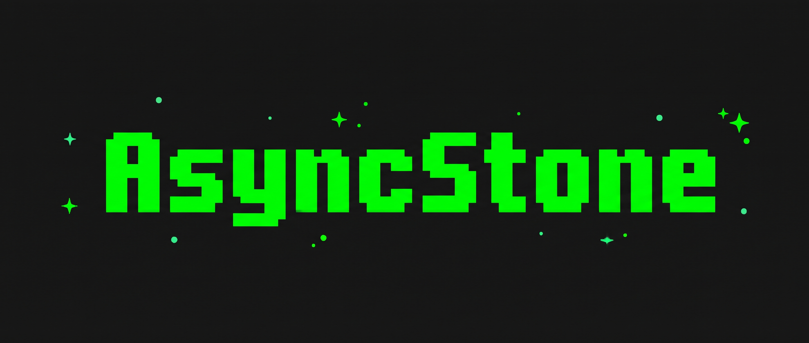

<p align="center">
  
</p>

## The Successor to KGenerators

AsyncStone is a block generator management plugin. It replaces KGenerators — a project that is currently archived and unsupported. Thanks to asynchronous task processing, it handles thousands of generators on the server without burdening the main thread.

---

## Features

- Upgrade tree. A basic generator can be upgraded to produce rarer materials, such as iron, diamonds, or custom items.
- Two generation modes: `"above"` spawns items above the generator, and `"replace"` replaces the block itself.
- Configurable percentage chances for specific materials to drop (e.g., 50% for stone, 10% for diamond).
- Separate crafting recipes for each generator.

---

## Configuration

Multi-level settings are defined in a YAML file. Generators may require specific resources to advance to the next level:

```yaml
default-generator:
  id: END_STONE
  name: "&e&lStone Generator!"
  lore:
    - "&7Place this block on the ground"
    - "&7to start generating stone."
  type: above
  cooldown: 40
  blocks:
    - "STONE:90.0"
    - "COBBLESTONE:10.0"
  upgrade:
    gen: generator-level-2
    cost:
      - "money:1000"
      - "item:DIAMOND:5"

generator-level-2:
  id: OBSIDIAN
  name: "&e&lStone Generator! &7[&cLevel 2&7]"
  type: above
  cooldown: 20
  blocks:
    - "STONE:50.0"
    - "COAL_ORE:20.0"
    - "DIAMOND_ORE:10.0"
